### ❯ latest projects

  
  

  
  

Applarchy in action — <a href="https://applarchy.vercel.app">try every effect in your browser</a>

### ❯ stack

### ❯ activity

<picture>
  <source media="(prefers-color-scheme: dark)" srcset="https://raw.githubusercontent.com/CaptainCompileon/CaptainCompileon/output/snake-dark.svg">
  
</picture>
